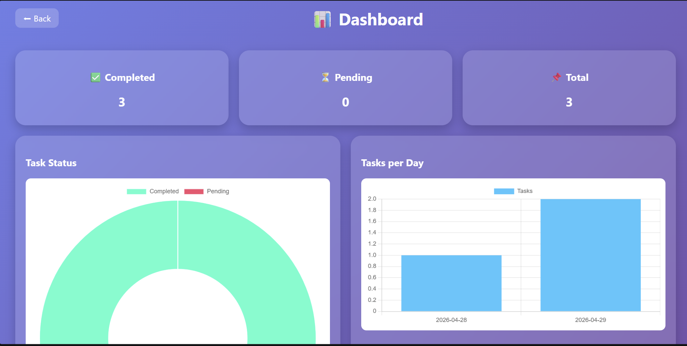
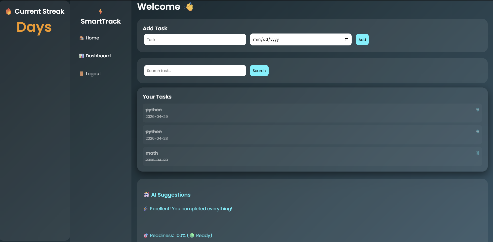
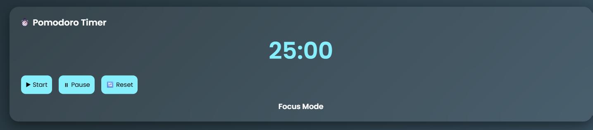
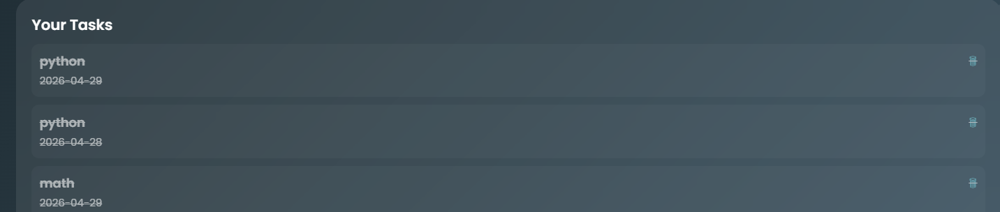

# 📚 Intelligent Study Tracker

### A Smart Student Study Management and Productivity Tracking Application

Intelligent Study Tracker is a web-based productivity application designed to help students organize their study schedules, manage academic tasks, track study sessions, and improve their learning consistency.

The application provides a centralized dashboard with productivity tools to make studying more organized and effective.

## ✨ Features

- **User Authentication** – Student registration and login.
- **Task Management** – Create, manage, complete, and track study tasks.
- **Calendar Planner** – Organize study schedules and deadlines.
- **Pomodoro Timer** – Improve concentration using focused study sessions.
- **Study Streak Tracking** – Monitor study consistency.
- **Smart Study Suggestions** – Generate recommendations based on pending tasks and subject workload.
- **Productivity Dashboard** – View study-related information in one place.

## 🛠️ Tech Stack

| Technology | Purpose |
|---|---|
| Python | Backend Programming |
| Flask | Web Framework |
| SQLite | Database |
| HTML5 | Frontend Structure |
| CSS3 | Styling |
| JavaScript | Frontend Interactivity |

## 📂 Project Structure

```text
Intelligent-Study-Tracker/
│
├── static/
│   └── style.css
│
├── templates/
│   ├── calendar.html
│   ├── dashboard.html
│   ├── index.html
│   ├── login.html
│   ├── pomodoro.html
│   ├── signup.html
│   └── streak.html
│
├── app.py
├── requirements.txt
├── .gitignore
└── README.md
```

## ⚙️ Installation and Setup

Follow these steps to run the project locally.

### 1. Clone the Repository

```bash
git clone https://github.com/Mohamed-Sohail-N/Intelligent-Study-Tracker.git
```

### 2. Navigate to the Project Directory

```bash
cd Intelligent-Study-Tracker
```

### 3. Create a Virtual Environment

```bash
python -m venv venv
```

### 4. Activate Virtual Environment

For Windows:

```bash
venv\Scripts\activate
```

### 5. Install Dependencies

```bash
pip install -r requirements.txt
```

### 6. Run the Application

```bash
python app.py
```

Open your browser and visit:

http://127.0.0.1:5000/

## 🎯 Project Objectives

- Help students organize their daily study activities.
- Improve time management and productivity.
- Encourage consistent learning habits.
- Provide a structured way to monitor academic tasks.
- Make study planning easier through productivity tools.

## 📸 Application Screenshots

### Dashboard


### Calendar Planner


### Pomodoro Timer


### Task Management


## 🚀 Future Improvements

- AI-powered personalized study recommendations.
- Advanced productivity analytics and visualizations.
- Cloud database integration.
- Email and browser notifications.
- Deployment for public access.
- Mobile-friendly responsive interface.

## 👨‍💻 Developer

**Mohamed Sohail N**

GitHub: https://github.com/Mohamed-Sohail-N

Project: Intelligent Study Tracker

---

⭐ If you find this project useful, consider giving the repository a star!